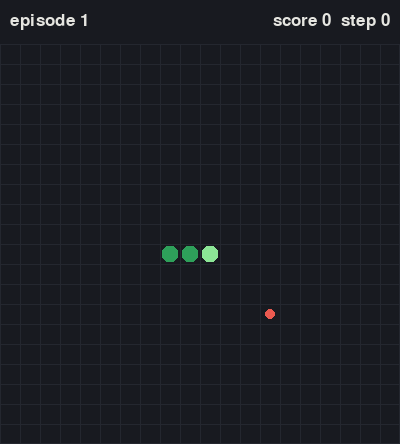
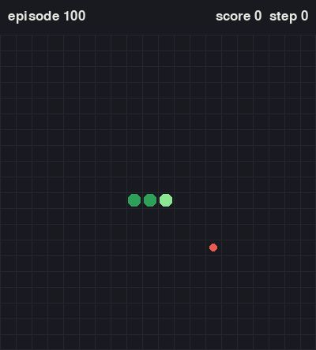
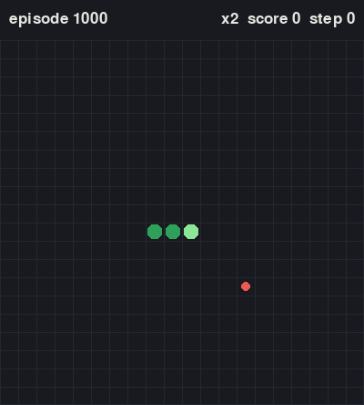
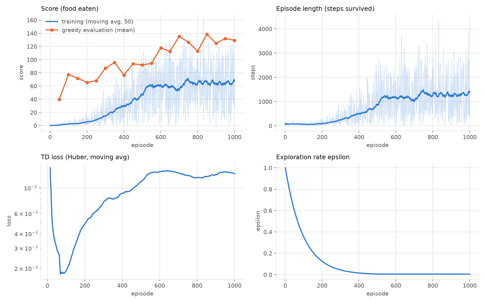

# Snake DQN: Deep Q-Learning on a 20x20 Grid
A Deep Q-Network (PyTorch) that learns to play Snake from scratch. The game is a pure-Python simulation with a pygame viewer; the agent sees a compact, egocentric 21-number description of the board, and its hyperparameters were tuned with a two-stage Optuna search that is validated across several training seeds.

---

## Overview
This repository contains a complete, reproducible DQN pipeline: environment, agent, training loop, evaluation tools, hyperparameter optimization and visualizations.
It was built as a hands-on project to practise value-based reinforcement learning: Double DQN, a target network, a replay buffer and epsilon-greedy exploration, together with an evaluation that does not rely on lucky runs (held-out games, several training seeds, paired comparisons).

The final agent eats **132.6 food on average per game** (median 127, maximum 214) on 100 games it never trained on. A random agent eats about 0.1.

---

## Visualization

### The agent at different stages of training
<table>
  <tr>
    <th>Episode 1</th>
    <th>Episode 100</th>
    <th>Episode 1000 (final)</th>
  </tr>
  <tr>
    <td align="center" width="33%">
      
    </td>
    <td align="center" width="33%">
      
    </td>
    <td align="center" width="33%">
      
    </td>
  </tr>
  <tr>
    <td><em>Score 0. The nearly untrained agent wanders until the 200-step idle limit cuts the game off.</em></td>
    <td><em>Score 75. It already finds food reliably.</em></td>
    <td><em>Score 146 (shown at 2x speed).</em></td>
  </tr>
</table>

Each GIF is **one** greedy game of the snapshot saved after that episode, all on the same food sequence (seed 123), so the only thing that changes between them is the network. They are single games, not averages: over 100 other games the final model scores 132.6 on average (see [Results](#results--comparative-analysis)).

### Training curves

*One training run: 21 features, tuned hyperparameters, 1000 episodes, seed 42.*

| Panel | What it shows | What to read from it |
| :--- | :--- | :--- |
| **Score (food eaten)** | Light blue: score of every training episode. Dark blue: moving average over 50 episodes. Orange: greedy evaluation (mean of 10 games every 50 episodes). | Learning starts slowly, rises steeply between episodes ~300 and ~550, then flattens. The greedy evaluation lies at about 110-138 from episode 600 on, the training average at about 60-68. The gap comes from exploration noise (see below). |
| **Episode length** | Steps survived per training episode. | Games grow from ~100 steps to ~1300 steps on average in training. Greedy games last about 3700-4000 steps. |
| **TD loss (Huber, log scale)** | Moving average of the loss between predicted Q-value and its target. | Starts low because the untrained network predicts values near 0, then rises to about 10^-2 as rewards propagate and games get longer, and stays there. Judged progress by the score. |
| **Exploration rate epsilon** | Probability of a random move, decayed per episode. | Reaches its floor (0.0054) at about episode 500. |

**Why training is lower than evaluation:** training games still contain random moves, and a single random move can kill a long snake. The same final network scores 129.2 greedy but only 65.9 with 0.5 % random moves (see [Results](#results--comparative-analysis)), which matches the training average in the plot.

A longer run (2000 episodes) showed no further trend after episode ~750.

---

## Features
* **Pure-Python Snake environment**: relative actions (straight / right / left), shaped reward, idle-step cutoff, deterministic given a seed.
* **Egocentric 21-feature observation**: proximity to obstacles, food and tail direction, and flood-fill features that tell the agent how much free space each move leaves.
* **DQN components**: replay buffer, frozen target network, Double DQN targets, Huber loss, gradient-norm clipping, epsilon-greedy exploration.
* **Independent evaluation**: greedy evaluation on games that are never used for training, a `diagnose.py` that reports how games end, and an optional random-move mode to measure robustness.
* **Two-stage hyperparameter optimization** (Optuna): cheap, pruned screening with one seed, then confirmation of the best trials and the baseline on new seeds.
* **Paired ablations**: `compare.py` trains the current config and a variant on the same seeds and scores both on the same held-out games.
* **Pygame viewer and GIF recorder** for watching and documenting the agent.
* **24 unit tests** for the environment rules, features, replay buffer, DQN update and training loop.

---

## The Environment

### State (21 numbers)
The agent does not see pixels. `SnakeEnv.observe()` returns 21 floats, always from the snake's own point of view (ahead / right / left), so the network does not have to learn the same thing four times for four headings.

| # | Feature | Meaning |
| :--- | :--- | :--- |
| 0-2 | `obstacle_proximity` ahead / right / left | `1 / (1 + free cells before a wall or body)`; 1.0 = blocked right now |
| 3-4 | `food_ahead`, `food_right` | signed food offset along / across the heading, divided by grid size |
| 5-8 | `food_is_ahead/behind/right/left` | binary flags for the side the food is on |
| 9-11 | `room` ahead / right / left | `min(1, cells reachable after that move / snake length)`; below 1 means the move leads into a space smaller than the snake |
| 12 | `snake_length` | length / grid cells |
| 13-15 | `area` ahead / right / left | cells reachable after that move / all free cells, no cap |
| 16-18 | `tail_reachable` ahead / right / left | 1 if the region reachable after that move contains the snake's tail (a snake with a path to its tail is never fully trapped, because the tail keeps moving away) |
| 19-20 | `tail_ahead`, `tail_right` | signed tail offset along / across the heading, divided by grid size |

Actions are relative: `0` straight, `1` turn right, `2` turn left. The snake cannot reverse by construction. The tail cell counts as free in the rays and in the flood fill, because it moves away on the next step.

The `room`, `area` and `tail_reachable` features all come from one flood fill per candidate move. They are what lets the agent avoid trapping itself once it is long, which a plain 3-cell danger check cannot see.

### Reward
| Event | Reward |
| :--- | :--- |
| eat food | +1 |
| die (wall or own body) | -1 |
| any other step | +0.02 if the head got one cell closer to the food, -0.02 if one cell farther |

The distance term is small shaping: it speeds up early exploration and sums to the same value over any path to the food, so it does not reward wandering. After 200 steps without food the episode is cut off (`truncated`). That is not treated as a death, so the learning target still bootstraps.

---

## The Agent

| Component | Implementation |
| :--- | :--- |
| Q-network | MLP `21 -> 128 -> 128 -> 3`, ReLU, one Q-value per relative action |
| Exploration | epsilon-greedy, `eps = max(eps_end, eps_decay^(episode-1))`, decayed per episode |
| Replay buffer | circular numpy buffer (100k transitions), uniform sampling; learning starts after 1000 transitions |
| Target network | frozen copy of the online network, hard update every `target_update_every` gradient steps |
| Double DQN | the online network picks the next action, the target network scores it |
| Loss / optimizer | Huber loss, Adam, gradient-norm clipping at 10 |
| Update rate | one gradient step per environment step |
| Terminal handling | only a real death stops bootstrapping; time-limit cut-offs do not |

The final model was trained with the defaults in `src/config.py` (1000 episodes, seed 42).

---

## Results & Comparative Analysis

Scores are food eaten per game.

### Final model (`models/final.pt`)
100 greedy games on the food sequence of seed 1000, which is never used for training or model selection (`scripts/evaluate.py`):

| Mean | Median | Max | Mean steps |
| :---: | :---: | :---: | :---: |
| **132.6** | 127 | 214 | 3964 |

### How games end, and how fragile the policy is
60 games on seed 2000 (`scripts/diagnose.py`), greedy versus 0.5 % random moves (the exploration floor during training):

| | Greedy | 0.5 % random moves |
| :--- | :---: | :---: |
| Mean score (+- standard error) | 129.2 +- 4.8 | 65.9 +- 3.8 |
| Median score | 125 | 66 |
| Mean steps | 3745 | 1322 |
| Ended by own body | 65 % | 62 % |
| Ended by timeout (no food for 200 steps) | 23 % | 0 % |
| Ended by wall | 12 % | 38 % |

### Feature set
Same 100 games (seed 1000) for all rows:

| Model | Mean | Median | Max | Mean steps |
| :--- | :---: | :---: | :---: | :---: |
| Random agent | ~0.1 | | | |
| 13 features | 88.3 | 92 | 124 | 2082 |
| 21 features | 128.7 | 126 | 193 | 3650 |
| 21 features, tuned (`final.pt`) | **132.6** | 127 | 214 | 3964 |

The 13-feature run lacked `area`, `tail_reachable` and `tail_*`, and it also used earlier hyperparameters. This is one run per row, so it indicates that the flood-fill features help.

### Hyperparameter optimization
`scripts/hyperparameter_opt.py` works in two stages, because a single short training run is too noisy to trust:
1. **`search`**: short runs (one seed) with Optuna's TPE sampler and a median pruner that stops runs falling behind. A trial is scored by the *final* network on held-out games. The first trial is the current config, so the baseline is measured the same way.
2. **`confirm`**: the best trials and the baseline are trained again on *new* seeds for the full run length and compared on the same 100 held-out games.

A first, wide search (8 parameters including `hidden` and `shaping`) found nothing better than the hand-tuned baseline: the best candidate scored 95.2 against 101.3 for the baseline over 3 seeds. A second search around the baseline (6 parameters; `hidden = 128` and `shaping = 0.02` fixed) found one candidate that did better:

| Parameter | Baseline | Tuned |
| :--- | :---: | :---: |
| `lr` | 1e-3 | 3.95e-4 |
| `gamma` | 0.99 | 0.9945 |
| `target_update_every` | 500 | 459 |
| `eps_decay` | 0.99 | 0.9896 |
| `eps_end` | 0.005 | 0.005444 |
| `batch_size` | 64 | 64 |

Paired comparison with `scripts/compare.py` (5 training seeds, 600 episodes, same 100 held-out games per seed):

| Seed | Baseline | Tuned | Difference |
| :---: | :---: | :---: | :---: |
| 1000 | 104.8 | 109.4 | +4.6 |
| 1001 | 100.5 | 104.4 | +3.9 |
| 1002 | 98.6 | 108.8 | +10.2 |
| 1003 | 93.4 | 105.6 | +12.2 |
| 1004 | 95.8 | 105.5 | +9.6 |
| **Mean** | 98.6 | **106.7** | **+8.1** |

The tuned setting is better on all 5 seeds, and the mean gain (+8.1) is larger than the seed-to-seed spread of the baseline (std 4.4).

### Key Takeaways
1. **The agent learns a strong policy from the game rules alone**: about 0.1 food per game for a random agent against 132.6 for the trained one.
2. **Features appear to matter more than tuning here.** The score went from about 88 to about 130 with the flood-fill features, while tuning added about 8 points on top of a hand-tuned baseline.
3. **Tuning is worth doing only with multiple seeds.** One-seed search scores were far too optimistic, and the wide search did not beat the baseline at all.
4. **Training plateaus after ~700 episodes**; a 2000-episode run showed no further trend. Greedy evaluation points are noisy (10 games each, swings of ~25 between neighbours), so single points, including the one `best.pt` is chosen from, say little. The published model is `final.pt`.

### Next Steps
Ideas not yet tried: n-step returns, random start length and position, a hybrid network (CNN on the grid plus these features).

---

## Repository Structure

```text
rl_snake/
├── assets/                                   # GIFs and plot for this README
│   ├── ep00001.gif
│   ├── ep00100.gif
│   ├── final.gif
│   └── learning_curves_more_features_hyperpara.png
├── checkpoints/                              # training output: best.pt, final.pt, milestones/
├── models/                                   # published models
│   └── final.pt                              # model after the last episode (used for results above)
├── results/                                  # logs, curves and Optuna study
├── scripts/
│   ├── compare.py                            # paired comparison of the config with a changed variant
│   ├── diagnose.py                           # how do games end? greedy vs. with random moves
│   ├── evaluate.py                           # score a policy over many games (random agent if no checkpoint)
│   ├── hyperparameter_opt.py                 # two-stage Optuna search (search / confirm)
│   ├── plot.py                               # redraw the learning curves from the CSV logs
│   ├── record_gif.py                         # record checkpoints as GIFs
│   ├── train.py                              # train a DQN agent
│   └── watch.py                              # watch agents play in a pygame window
├── src/
│   ├── agent.py                              # Q-network, epsilon-greedy, Double-DQN update, checkpoints
│   ├── config.py                             # all hyperparameters (one dataclass)
│   ├── env.py                                # Snake game and the 21-feature observation
│   ├── evaluation.py                         # play games with any policy
│   ├── plotting.py                           # learning curves from the CSV logs
│   ├── renderer.py                           # pygame drawing (reads the env, never changes it)
│   ├── replay_buffer.py                      # circular numpy replay buffer
│   └── training.py                           # the training loop
├── tests/                                    # environment rules, features, replay buffer, DQN update, training loop
├── .gitignore
├── environment.yml                           # conda environment
├── pytest.ini
├── README.md
└── requirements.txt                          # pip packages (used by environment.yml)
```

---

## Dependencies

* **Python 3.12**
* **PyTorch**
* **NumPy**
* **pygame**
* **Matplotlib**
* **Pillow**
* **Optuna**
* **pytest**

---

## Usage

### 1. Environment Setup (conda)
Run from the project folder:
```bash
conda env create -f environment.yml
conda activate rl_snake
pytest
```
On Windows, `pip install torch` typically installs a CPU build. That is enough since the network is tiny and training runs on the CPU by default.

### 2. Running Scripts
```bash
# watch the published model play (N = next, ESC / Q = quit)
python scripts/watch.py --checkpoint models/final.pt

# score it on 100 games, and see how games end
python scripts/evaluate.py --checkpoint models/final.pt --games 100
python scripts/diagnose.py --checkpoint models/final.pt --games 60 --epsilons 0 0.005

# baseline: random agent
python scripts/evaluate.py

# train own agent (defaults from src/config.py)
python scripts/train.py
python scripts/train.py --episodes 600 --seed 1
python scripts/watch.py            # replay the milestone snapshots of that run
python scripts/plot.py             # redraw results/learning_curves.png (also works mid-training)

# record GIFs
python scripts/record_gif.py

# hyperparameter optimization (stage 1, then stage 2)
python scripts/hyperparameter_opt.py search  --trials 40 --jobs 4
python scripts/hyperparameter_opt.py confirm --top 3 --seeds 3

# compare the current config with a changed variant on the same seeds
python scripts/compare.py --set lr=0.0005 --set gamma=0.99 --seeds 5
```
`train.py` writes `results/` and `checkpoints/` and overwrites the old milestone snapshots at the start of each run.

---

## References

**Papers**:
  > Volodymyr Mnih et al. *"Human-level control through deep reinforcement learning"*, Nature, 2015.

  > Hado van Hasselt, Arthur Guez, David Silver. *"Deep Reinforcement Learning with Double Q-learning"*, AAAI, 2016.
